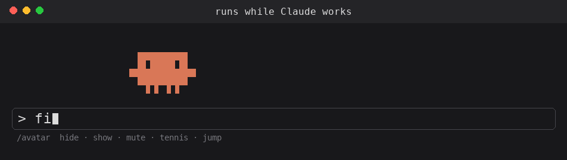
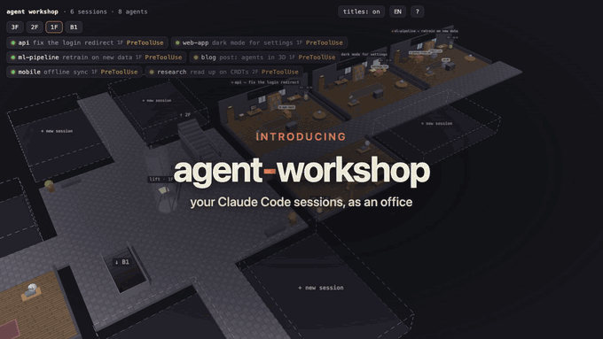

# markmerk-mods

A small [Claude Code](https://claude.com/claude-code) plugin marketplace with two mods:

| Mod | What it is |
| --- | --- |
| [**runner-avatar**](#runner-avatar) | a small Claude avatar above your prompt that runs while Claude works and reacts to what it does |
| [**agent-workshop**](#agent-workshop) | a workshop where Claude and its subagents walk between tool stations: a pixel-art pane in the terminal, and a 3D window with a room for every session, where you can prompt them and answer their permission requests. In English and German |

## Install

```sh
claude plugin marketplace add MarkMerk/markmerk-mods
claude plugin install runner-avatar@markmerk-mods
claude plugin install agent-workshop@markmerk-mods
```

Then start a new Claude Code session. To update later, `claude plugin marketplace update markmerk-mods`;
to remove a mod, `claude plugin uninstall <name>@markmerk-mods`.

## runner-avatar

A small Claude avatar lives in the band above your prompt and reacts to what Claude is doing.



| When | The avatar |
| --- | --- |
| Nothing is happening | strolls slowly back and forth, plays a short game of tennis after about 20 seconds, then falls asleep (`zZz`) |
| You send a prompt | stops and looks up (`!`) |
| Claude is working | runs, and its bubble shows the current tool: the start of a Bash command, the file being read or edited, `searching`, `browsing`, … plus how full the context window is |
| A tool call fails or is blocked | flinches (`oops` / `blocked`) |
| A subagent is working | a small copy of it runs alongside (up to three) |
| The turn ends | does a little dance (`done ✓ 12s`), or shows `stopped` / `error` |
| The turn took 15 s or longer | plays a short chime, so you can look away while Claude works |
| Context is 85 % full or more | turns red |
| You click it | hops |

In the desktop app it is drawn as a vector image instead of block characters.

| Command | Does |
| --- | --- |
| `/avatar` | hide or show the avatar |
| `/avatar hide` · `/avatar show` | the same, explicitly |
| `/avatar mute` · `/avatar unmute` | turn the end-of-turn chime off or on |
| `/avatar stay` · `/avatar roam` | keep it in one spot (it still runs on the spot, hops and reacts), or let it run back and forth again |
| `/avatar tennis` | start or stop a game of tennis (needs a terminal at least ~48 columns wide) |
| `/avatar jump` | make it hop |

Hide, mute and stay are remembered between sessions.

## agent-workshop

Watch Claude and its subagents work, and use all your sessions from one window.



▶ [The full one-minute tour, as a video](assets/agent-workshop-demo.mp4): rooms, subagents, thinking and writing,
the answer pile, couriers, floors, permissions from the window, new sessions and the nap.

### The terminal pane

`/workshop` opens a pane with a small pixel-art workshop.

- **The room** is drawn in a three-quarter view, like an old RPG, with half-block pixels, so it
  works in any terminal (the desktop app draws it as a picture; a pane too small for a room lists
  the agents in words). It has six stations: a desk with a monitor for `shell` (Bash), a bookshelf
  for `files` (Read, Grep, Glob), a writing desk with a lamp for `edit` (Edit, Write), a radio for
  `web` (WebFetch, WebSearch), a server rack for `mcp` (any MCP tool) and a round table with an orb
  for `agents` (Agent and the rest).
- **Claude** walks to the station of each tool it calls, faces it and types, and the station
  comes alive. **Subagents** come in through the door as smaller figures in their own colors and
  leave the same way when they finish. A bubble over each says what it is doing: `?` while it
  waits for your permission, `oops` when a call fails, `done ✓ 12s` at the end of a turn. Idle for
  40 seconds, Claude dozes.
- **Hooks**: the header names the last settings hook event that fired (`PreToolUse`,
  `SubagentStart`, `Stop`, …) and who raised it. Press `h` for a table of every hook event, how
  often it fired this session and when it fires; `f` goes back to the room. Hook events fire
  whether or not you have hooks configured, so you can see where a hook of yours would run.

### The 3D window

`/workshop 3d` opens a window (Chrome's app window when Chrome is installed, else your default
browser) with real 3D, lighting and shadows, and a room for every Claude Code session running
this mod, in any project.

**The building**
- Three rooms along one side of a corridor, then three facing them; then corridors east, west,
  north and south of a hall; then floors above and below, joined by a glass lift and stairs.
  Click the stairs or a floor button at the top to change floors.
- Each room has its project's name over it and a lamp over its door: green while the session
  works, amber while it waits for you, red while it ends. The wall between the camera and a room
  is cut away, so no room hides another.
- Move around like a map: drag to move, right-drag to turn, scroll to zoom, arrows or WASD to
  walk. Click a session's chip at the top, or a room, to fly there.

**What a room shows**
- Claude and its subagents at the stations of the tools they call, as in the pane; a thought
  cloud while an agent thinks; Claude napping on the rug, z's rising, when idle.
- A screen on the back wall with the answer as it streams, or the model's thinking.
- Finished answers carried to a tray by the door as sheets, thicker for longer answers; the
  latest edit's diff hanging over the editing desk.
- A flask that fills with the context window (amber from 60 %, red from 85 %), with what the
  session has cost.
- **Couriers**: when one session messages another (Claude's SendMessage tool), a small Claude
  carries an envelope from the sender's room through the corridors (by the lift between floors)
  into the receiver's.

**Using a session from the window**: click a room to open its panel, laid out like a chat.
- Type a prompt and press Enter: it goes to that session at once and starts when the session is
  free. `/` opens a menu of the session's slash commands, which run as if typed in its terminal;
  `@` a menu of the project's files; paste or drop files to attach them.
- The header shows the model (click to switch it with `/model`) and the permission mode;
  **Stop** ends the running turn. Tabs: **Chat** (the conversation with the tools each answer
  used), **Edits** (each edit's diff), **Activity** (agents, tool calls, hook events); the todo
  list shows above them while there is one.
- **Permission requests, plans and questions** show in the panel with what the session wants to
  do (the file, the command, the edit's diff): **Allow**, **Always allow** (the rule the terminal
  would offer, listed), **Allow + accept edits**, **Deny**; plans from plan mode can be approved
  and Claude's multiple-choice questions answered. The window gets 25 seconds (two minutes for a
  plan or a question); then the terminal asks as usual.

**Starting, moving and ending sessions**
- On the floor in view, the first free room on every side of every corridor is a dashed
  **+ new session**: pick a folder (the system's dialog, a recent project, or a path), and a
  Terminal window opens running `claude` there, or `claude --continue` (macOS). **Choose another
  spot…** puts its room wherever you click, on any floor.
- **⇄** in a session's panel moves its room; the session remembers its spot.
- **⏻** ends a session after asking: Claude waves goodbye at the door, the session exits as
  `/exit` does, and the room folds away.

**Guests**: sessions running on this machine without the mod (started before it was set up) get
rooms too, in a look of their own (deep-water walls, a teal rug, a velvet rope, a 👁 guest sign),
read from their processes and transcripts. They are to watch only; restarting one with
`claude --continue` makes it a room of its own.

**Tours**: the main tour shows each time the window opens until you tick **Don't show this
again**; the **?** menu has it and shorter tours on each part, with what they talk about lit up.

**Turn titles** (off by default): the **titles** switch at the top asks first, then has every
session send each prompt to Haiku for a 3–6 word title, shown on the room's sign. That is one
small extra request a turn, and it costs tokens.

### Language

The workshop speaks English and German. **EN/DE** at the top of the window, or `/workshop lang de`
(`lang en`) in any session, switches the window, its tours and the terminal pane together; every
session shares the choice. Until one is made, the window follows the browser's language.

### Commands

| Command | Does |
| --- | --- |
| `/workshop` | open the pane |
| `/workshop hooks` · `/workshop floor` | open it on the hooks table or the room |
| `/workshop close` | close it |
| `/workshop 3d` · `/workshop 3d off` | open the 3D window, or close it down |
| `/workshop lang de` · `/workshop lang en` | German or English, here and in the window |
| `/workshop clear` | reset the hook counts |
| `/workshop auto` | open the pane with every session (on terminals 144 columns or wider), or stop that |
| `/workshop help` | all of the above |

### Requirements and how it works

The pane needs nothing. The 3D window needs `python3` to send commands (without it, the window
opens as a file and can only watch); starting sessions and the folder dialog are macOS only.

The session that opens the window runs a small server, `web/server.py`, on `127.0.0.1` only.
While a window is in use, every session with the mod writes its state into
`~/.claude/agent-workshop/` a few times a second and reads the commands the window leaves for it
there. Commands need a random token that only the page gets from the server. With no window
open, nothing is written. The details are below.

## Privacy and security

**runner-avatar** makes no network calls, reads and writes no files, runs no processes and calls
no models. It uses the tool calls Claude makes (to label its bubble on your own screen, cut to 28
characters; keep that in mind when screen sharing), the session's context usage, and Claude
Code's local plugin store for three on/off settings (`isHidden`, `isMuted`, `isPinned`).

**agent-workshop**'s terminal pane writes nothing and sends nothing. The 3D window is where it
does more:

- **When.** Sessions share their state only while a window is in use: from the moment its page
  starts talking to the window's server until about 10 seconds after it stops (the server beats a
  heartbeat while the page asks it for anything). Without `python3` the window opens as a file to
  watch only, and the session that opened it keeps sharing on until `/workshop 3d off` or until it
  ends.
- **What, and where.** Into `~/.claude/agent-workshop/`, every session with the mod writes: its
  project folder; its agents and the tool calls they make (commands, file names, search patterns,
  URLs); up to 60 messages of its conversation, its last 12 answers with their prompts, the answer
  as it streams and what the model thinks; its edits' diffs; its todo list; its slash commands and
  what they printed, and the project's file list; messages to and from other sessions; context
  use and cost; and the whole input of a permission request waiting on the window (up to 20,000
  characters: for a Write, the file's content). The session running the window also reads the end
  of the transcripts of sessions running **without** the mod (guests, which cannot opt out),
  shell output included, and writes the same for them; and lists up to 30 folders sessions ran
  in, from `~/.claude/projects/`. Files you attach are kept in `uploads/`.
- **How long.** A session removes its own files, inbox and uploads when it ends. While a window is
  in use, the session running it clears every minute what was left behind: the files of sessions
  that stopped updating 10 minutes ago (a crash), answers nobody waited for, used launchers and
  keys, inboxes of sessions gone; the server clears uploads older than 7 days. Closing the window
  with `/workshop 3d off` removes the guests' files. With no window ever opened again, leftovers
  stay until one is.
- **Who can read it.** The folder is set to `0700` (only you) when the window opens and again
  every couple of seconds while sessions share; files inside may be readable by others, so it is
  the folder's mode that keeps other accounts out. The window's server listens on `127.0.0.1`
  only. Its token is never printed, put on a command line or written into a page: the browser
  opens a launcher file in the private folder, which hands the page a one-time key that the page
  trades for the token once. Without the token the server shows nothing but the page itself; it
  also refuses other host names, requests from other web sites, and being framed. Programs running
  as you can read your private folder, and so the sessions' state, as they can read anything
  else of yours.
- **Who can command it.** The window can send a session a prompt (it arrives as your own words),
  run its slash commands, stop it, start and end sessions, and answer its permission requests,
  plans and questions: "always allow" lists the rules it would add, "accept edits" is offered for
  edits and plans. It allows only what it shows whole: a request too long to show, hiding
  characters that reorder text, or running outside the sandbox can only be denied from the window,
  and allowed in the terminal. Commands travel as files in the private folder, so a program
  running as you could write them, as it could edit your Claude Code settings. Claude itself is
  refused any tool call that reads or writes that folder or reaches the window's server; this
  check is best effort (it reads paths and text), so for a fence the engine enforces, add deny
  rules to your settings, for example
  `"permissions": { "deny": ["Read(~/.claude/agent-workshop/**)", "Edit(~/.claude/agent-workshop/**)"] }`.
- **What leaves the machine.** The window loads three.js, its OrbitControls, marked and DOMPurify
  from cdnjs and jsDelivr, each pinned by hash; the server allows those four files and nothing
  else from outside. With **titles** switched on (a setting all sessions share), the first 2,000
  characters of each prompt go to Haiku for a title, which costs tokens. Nothing else is sent
  anywhere.
- **Commands it runs.** `python3` (the server), `open` or `xdg-open` (the browser, the launcher, a
  Terminal), `sh` (waiting for an answer, listing transcripts), `osascript` (the folder dialog),
  `pgrep`, `lsof`, `ls`, `tail`, `head`, `grep`, `stat` (finding guests and recent projects),
  `git ls-files` with the repository's fsmonitor and hooks off, or `find` outside a repository
  (the file list), `kill -0` (is the window's server alive), `mkdir`, `chmod`, `rm`.

## Layout

```
.claude-plugin/marketplace.json     the catalog Claude Code reads
assets/runner-avatar.gif            the runner-avatar demo above
assets/agent-workshop.gif           the agent-workshop highlights above
assets/agent-workshop-demo.mp4      its full one-minute video
plugins/runner-avatar/
├── .claude-plugin/plugin.json      name, version, description
├── README.md                       short readme for the plugin itself
├── hooks/hooks.json                points at register.js
├── hooks/register.js               moods, tennis, /avatar, chime
├── hooks/sprite.js                 draws the avatar and catches clicks
├── sounds/done.aiff                the end-of-turn chime
└── tests/runner-avatar.test.ts
plugins/agent-workshop/
├── .claude-plugin/plugin.json      name, version, description
├── README.md                       short readme for the plugin itself
├── hooks/hooks.json                points at register.js
├── hooks/register.js               agents, hook counts, /workshop, the pane, the sessions' shared state
├── hooks/scene.js                  the pixel art: room, stations, agents
├── hooks/words.js                  the terminal side's German
├── web/workshop.html               the 3D window (three.js), with its own German
├── web/server.py                   its server: the page, the state, the commands, behind a token
├── tests/agent-workshop.test.ts
└── tests/test_server.py
```

## Development

Load the mods from this checkout instead of the marketplace with
`claude --plugin-dir plugins/runner-avatar --plugin-dir plugins/agent-workshop`, and run
`/reload-plugins` after a change. Checks:

```sh
claude plugin validate plugins/agent-workshop
claude plugin test plugins/runner-avatar
claude plugin test plugins/agent-workshop
cd plugins/agent-workshop && python3 -m unittest discover -s tests -p 'test_*.py'
```

## License

MIT, see [LICENSE](LICENSE).
